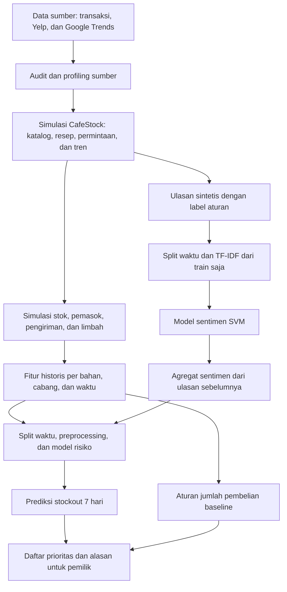

# Alur dan tahapan proyek ML CafeStock

> Pembaruan ruang lingkup 2026-11-05: pengguna memilih sentimen pasar tentang
> menu di media sosial berdasarkan wilayah, bukan ulasan kafe sendiri.
> Lihat [rancangan terbaru](sentimen_pasar_menu.md). Bagian ulasan cabang di
> dokumen ini menjelaskan rancangan/generator sebelumnya dan perlu diganti
> sebelum implementasi model operasional. CSV yang ada belum diubah.

Dokumen ini adalah rencana implementasi, bukan laporan model yang sudah dilatih.
Dataset, generator, aturan restok baseline, validasi, dan skema PostgreSQL sudah
tersedia. Notebook training, evaluasi model, dan aplikasi pemilik belum dibuat.
Verifikasi generator saat penyusunan rencana: 144/144 pemeriksaan lulus dan 23/23
CSV identik pada dua generasi. Ini merupakan validasi data, bukan akurasi ML.

## Tujuan dan batas keluaran

Unit keputusan adalah satu bahan, satu cabang, pada satu waktu keputusan.
Pemilik menerima daftar prioritas bahan, prediksi stockout dalam 7 hari,
stok tersedia, pesanan berjalan, saran jumlah pembelian, dan alasan yang jelas.

Ruang lingkup inti:

- Sentimen: TF-IDF + Linear SVM; Multinomial Naive Bayes sebagai pembanding.
- Risiko stockout: Random Forest Classifier; Logistic Regression sebagai pembanding.
- Jumlah pembelian: aturan baseline persediaan yang sudah ada; bukan hasil ML
  dan belum boleh disebut optimal. Prediksi risiko mengubah informasi/prioritas,
  bukan otomatis menambah jumlah pesanan.
- Tren pasar: fitur tambahan; manfaatnya diuji melalui eksperimen tanpa/dengan tren.

Untuk mengklaim perbaikan jumlah restok atau optimasi, diperlukan tahap lanjutan
prediksi kebutuhan bahan dan/atau pemilihan kebijakan pembelian, lalu backtesting.

## Alur data sampai pemilik

Alur ini bersifat rancangan end-to-end. Fitur sentimen CSV saat ini berasal dari
label aturan generator, bukan prediksi SVM. Evaluasi awal dengan fitur tersebut
harus diberi nama eksperimen sentimen referensi. Untuk alur realistis, buat fitur
dari prediksi teks yang dihasilkan model tanpa akses ke masa depan.

## Tahapan notebook

Nama berikut adalah susunan kerja yang diusulkan; file notebook belum dibuat.
Split diletakkan sebelum encoding/imputasi yang mempelajari distribusi data.

| Tahap | Pekerjaan | Keluaran yang diperiksa |
|---|---|---|
| 01_raw_dataset | Inventarisasi sumber, URL, lisensi, hash, rentang waktu; pisahkan observasi asli dan simulasi | Daftar sumber dan laporan audit |
| 02_data_cleaning | Periksa duplikat, nilai kosong, satuan, tanggal, ID dan relasi; catat setiap perlakuan | Data konsisten dan log cleaning |
| 03_eda | Pelajari penjualan, konsumsi, stok, limbah, label sentimen dan stockout; analisis yang memengaruhi pemodelan memakai train | Grafik serta hipotesis penelitian |
| 04_feature_engineering | Bentuk konsumsi historis, stok tersedia, pesanan berjalan, atribut pemasok, tren lag, dan sentimen masa lalu | Tabel fitur bertimestamp dan target terpisah |
| 05_split_70_15_15 | Gunakan pembagian kronologis yang tersedia; buang jendela lintas batas dan target tersensor sesuai tugas | Indeks train, validation, test, purged |
| 06_encoding | Fit TF-IDF, imputasi, encoding cabang/bahan dan scaling bila diperlukan pada train saja; transform validation/test | Pipeline preprocessing yang tersimpan |
| 07_modeling | Latih pembanding dan model utama; pilih parameter serta ambang keputusan menggunakan validation | Model dan konfigurasi terpilih |
| 08_evaluation | Nilai model final pada test; bandingkan penggunaan tren dan sentimen dengan prosedur yang sama | Tabel metrik, confusion matrix, analisis kesalahan |
| 09_explainability | Periksa kontribusi fitur dan contoh prediksi; bedakan alasan aturan stok dan penjelasan model | Ringkasan faktor serta rancangan kartu keputusan |

Sumber cleaning dan audit sudah ada dalam src/audit.py dan src/profile.py.
Feature engineering, simulator, dan split awal sudah ada dalam src/. Notebook
berfungsi sebagai eksperimen terstruktur yang menggunakan pipeline tersebut,
bukan membuat salinan logika generasi yang berpotensi berbeda.

## Definisi fitur dan target

### Sentimen

- Sumber: output/sentiment_ml_dataset.csv.
- X: review_text. Rating, ID, tanggal, split dan label tidak menjadi fitur teks.
- y: sentiment_label, empat kelas: positive, neutral, negative, mixed.
- Fit kosakata dan bobot TF-IDF pada train saja; simpan bersama classifier.
- Periksa teks identik antarpartisi; jangan menggeser data masa depan ke train
  demi menghilangkan duplikasi. Dokumentasikan perlakuan dan keterbatasannya.
- Ulasan berupa template sintetis; skor tinggi tidak membuktikan kualitas NLP nyata.

### Risiko persediaan

- Sumber: output/inventory_risk_ml_dataset.csv.
- X: gunakan allowlist risk_features di docs/feature_manifest.json.
- y: target_stockout, ada/tidaknya kejadian kekurangan bahan selama 7 hari berikutnya
  di bawah kebijakan historis simulator.
- Baris: satu ingredient_id, branch_id, decision_at.
- Jangan masukkan target_stockout, risk_label, label_window_end, label_observed,
  ID baris atau informasi masa depan sebagai fitur. Jangan gunakan baseline_purchase_qty
  sebagai jalan pintas target risiko.
- Stok tersedia dan pesanan berjalan menggambarkan keadaan pukul 05:00 sebelum
  pesanan yang dibuat pada keputusan itu sendiri.
- Mean konsumsi memakai 14 hari selesai sebelumnya; history_days=0 memakai prior
  engineering, bukan masa depan. Uji sensitivitas dengan mengecualikan warm-up.

### Jumlah pembelian

- Sumber: output/restock_decision_dataset.csv.
- baseline_purchase_qty adalah keluaran aturan referensi, dalam satuan dasar bahan.
- Melatih regresi langsung terhadap kolom ini hanya meniru aturan tersebut;
  itu bukan bukti optimasi dan tidak membuktikan manfaat tren/sentimen.
- Untuk keluaran inti, tampilkan angka baseline dengan sumber perhitungannya.

## Integrasi tren pasar

- geoMap.csv adalah geografis; jangan jadikan urutan kota sebagai urutan waktu.
- multiTimeline.csv adalah tren matcha mingguan Jawa Tengah. Tidak ada padanan
  observasional yang sah dengan penjualan CafeStock NYC.
- market_trends.csv merupakan simulasi per kategori. Tren memengaruhi komposisi
  permintaan produk dengan lag sekurangnya 7 hari, bukan total transaksi harian.
- Fitur market_interest_latest saat ini merupakan rata-rata indeks terakhir dari
  kategori yang menggunakan suatu bahan; tambahkan kandidat lag 1 minggu dan
  perubahan mingguan saat eksperimen. Jangan memakai realisasi minggu depan.
- Untuk klaim operasional dengan Google Trends nyata, samakan wilayah, istilah,
  periode, resolusi waktu dan ketersediaan publikasi dengan objek bisnis.
- Ekspor historis Google Trends bersifat relatif dan dapat memanfaatkan normalisasi
  seluruh rentang; jangan menganggap semua nilai yang diunduh belakangan persis
  sama dengan informasi yang tersedia pada tanggal keputusan historis.
- Dalam data sintetis, pengaruh tren sengaja diasumsikan. Keberhasilan model
  menunjukkan pemulihan pola simulasi, bukan bukti pengaruh pasar nyata.

## Pembagian waktu yang sudah tersedia

Proporsi nominal 70/15/15 ditentukan sebelum purge. Proporsi akhir berbeda setelah
mengeluarkan jendela label yang melintasi batas dan jendela terminal tersensor.
Gunakan kolom split setiap dataset; jangan membagi ulang secara acak.

| Bagian keputusan restok/risiko | Tanggal lokal NYC |
|---|---|
| Train setelah purge | 2025-11-04 s.d. 2026-07-10 |
| Purged pada batas pertama | 2026-07-11 s.d. 2026-07-17 |
| Validation setelah purge | 2026-07-18 s.d. 2026-09-03 |
| Purged pada batas kedua | 2026-09-04 s.d. 2026-09-10 |
| Test secara kalender | 2026-09-11 s.d. 2026-11-03 |
| Test dengan label risiko lengkap | 2026-09-11 s.d. 2026-10-27 |

Untuk tugas risiko, filter split != purged dan label_observed == 1. Baris akhir
2026-10-28 s.d. 2026-11-03 tetap berguna sebagai keadaan keputusan, tetapi tidak
bisa dipakai menilai label stockout 7 hari penuh. Dataset sentimen tidak memiliki
label_observed; gunakan kolom split-nya sendiri dan pemeriksaan duplikasi teks.

## Menghubungkan model sentimen ke model risiko

1. Selesaikan model sentimen dan preprocessing hanya dengan train/validation yang sah.
2. Untuk fitur risiko pada periode train, gunakan prediksi out-of-fold berurutan
   waktu: classifier setiap fold hanya dilatih pada ulasan yang lebih awal.
3. Untuk validation/test, setiap prediksi ulasan harus berasal dari model yang
   hanya menggunakan data latih lebih awal sesuai protokol yang telah dikunci.
4. Agregasikan prediksi ulasan dalam 14 hari sebelum setiap keputusan. Tidak ada
   ulasan sesudah decision_at yang boleh dipakai.
5. Tangani awal periode tanpa model/ulasan dengan nilai netral dan indikator
   ketersediaan; jangan melatih menggunakan ulasan masa depan untuk mengisi awal.
6. Laporkan hasil fitur sentimen referensi dan fitur sentimen prediksi secara terpisah.

Sentimen tidak dimasukkan sebagai penggerak permintaan dalam generator sekarang.
Manfaat prediktifnya bisa kecil atau tidak ada. Hubungan tambahan melalui volume
ulasan atau kondisi cabang harus diuji, bukan diklaim sebagai sebab-akibat.

## Rancangan eksperimen kontribusi fitur

Gunakan keluarga model, split, anggaran tuning, dan prosedur evaluasi yang setara.
Pilih parameter pada validation; test hanya untuk pelaporan final. Jika dilakukan
seleksi fitur, lakukan pada train/validation sebelum membuka hasil test.

| Eksperimen | Fitur |
|---|---|
| A | Operasional: stok, konsumsi, cabang, bahan, pemasok |
| B | A + tren pasar |
| C | A + fitur ulasan/sentimen |
| D | A + tren pasar + fitur ulasan/sentimen |

Sebutkan apakah kelompok sentimen mencakup review_count_14d. Untuk mengisolasi
polaritas teks dari volume ulasan, jalankan pembanding tambahan yang menjaga
review_count_14d sama dan hanya menambah sentiment_mean_14d. Tidak ada kewajiban
bahwa B atau D harus menang; hasil nol/negatif juga merupakan hasil penelitian.

Metrik sentimen: macro F1, precision/recall/F1 per kelas, confusion matrix,
accuracy sebagai pelengkap. Metrik risiko: precision, recall stockout, F1,
PR-AUC dan confusion matrix. Jika menampilkan persentase risiko kepada pemilik,
evaluasi kalibrasi; skor model tidak otomatis merupakan probabilitas yang akurat.
Ambang peringatan dipilih di validation berdasarkan kompromi stockout dan alarm
palsu, lalu dikunci untuk test.

Explainability: permutation importance pada data evaluasi yang ditetapkan,
dengan interpretasi hati-hati terhadap fitur berkorelasi. Gunakan validation
untuk perubahan fitur, test untuk ringkasan final. Penjelasan model bukan bukti
sebab-akibat, dan faktor global bukan alasan pasti untuk setiap keputusan lokal.

## Tahap lanjutan untuk rekomendasi jumlah yang dipengaruhi ML

Ini bukan prasyarat untuk eksperimen klasifikasi risiko, tetapi diperlukan bila
ingin menguji perbaikan jumlah pembelian sebagai keluaran utama penelitian.

1. Tentukan horizon sesuai lead time dan interval peninjauan.
2. Bentuk target kebutuhan bahan masa depan dari permintaan produk dan resep.
   Pisahkan target kebutuhan laten dari konsumsi terpenuhi yang tersensor stockout.
   Simulasi menyediakan latent_demand; data kafe nyata biasanya tidak menyediakan
   seluruh permintaan yang gagal terpenuhi.
3. Bandingkan prediksi kebutuhan, misalnya Random Forest Regressor, dengan
   baseline rata-rata historis. Tabel target kebutuhan per bahan belum disiapkan
   sebagai dataset regresi khusus dalam keluaran sekarang.
4. Terjemahkan prediksi menjadi target stok, netting stok/pesanan, safety stock,
   pembulatan kemasan, MOQ dan batas kedaluwarsa. Tetapkan asumsi biaya terlebih dahulu.
5. Bandingkan kebijakan baru dan baseline menggunakan permintaan laten serta
   kondisi pemasok yang sama. Jalankan ulang simulator secara kronologis untuk
   setiap kebijakan: stok, pesanan, limbah dan fitur berikutnya berubah bersama
   kebijakan. Jangan hanya mengganti kolom rekomendasi pada ledger lama.
6. Ukur unit/kejadian stockout, fill rate, waste, biaya pembelian, biaya simpan
   dan penalti kekurangan sesuai definisi yang didokumentasikan.
7. Kunci kebijakan di validation, laporkan hasil final pada test. Klaim pengurangan
   biaya hanya dibuat dari hasil backtest aktual, bukan dari skor klasifikasi.

## Keluaran untuk pemilik kafe

Contoh isi kartu, tanpa mengarang hasil model:

- Cabang dan bahan; waktu data terakhir diperbarui.
- Stok tersedia, pesanan berjalan, serta cakupan stok berdasarkan pemakaian historis.
- Prediksi stockout 7 hari dan prioritas tindakan; persentase hanya bila terkalibrasi.
- Jumlah pembelian beserta satuan dan jumlah kemasan.
- Sumber jumlah: aturan baseline atau kebijakan berbasis prediksi yang sudah diuji.
- Alasan aturan yang bisa diverifikasi, misalnya stok di bawah titik pemesanan.
- Ringkasan tren/sentimen sebagai informasi pendukung, tanpa klaim kausal.

Tahap aplikasi/dashboard dilakukan setelah pipeline model dan keluaran keputusan
stabil. Untuk UTS cukup jelaskan rancangan ini dalam proposal, slide, dan video;
jangan mengklaim aplikasi atau model sudah jadi.

## Status dan urutan pelaksanaan berikutnya

| Pekerjaan | Status saat dokumen dibuat |
|---|---|
| Audit, profiling, katalog, resep dan simulasi stok | Tersedia |
| CSV, label, split awal, allowlist fitur dan PostgreSQL | Tersedia dan tervalidasi |
| URL/lisensi sumber serta dokumen proposal | Perlu dilengkapi |
| Notebook cleaning/EDA dan pemeriksaan leakage eksperimen | Belum dibuat |
| Model sentimen, risiko, dan evaluasi kontribusi tren | Belum dilatih |
| Regresi kebutuhan dan backtest kebijakan baru | Tahap lanjutan, belum dibuat |
| Explainability dan tampilan pemilik | Belum dibuat |

Mulai dengan 01 sampai 06, lalu selesaikan model sentimen, model risiko dan
eksperimen fitur. Setelah hasil evaluasi tersedia, tentukan apakah tahap lanjutan
prediksi kebutuhan diperlukan untuk menjawab rumusan masalah dan judul optimasi.

## Rujukan teknis

- Random Forest: https://scikit-learn.org/stable/modules/generated/sklearn.ensemble.RandomForestClassifier.html
- Linear SVM: https://scikit-learn.org/stable/modules/generated/sklearn.svm.LinearSVC.html
- Pencegahan leakage: https://scikit-learn.org/stable/common_pitfalls.html
- Google Trends: https://support.google.com/trends/answer/4365533?topic=13975
- Sumber proyek: docs/assumptions.md, docs/feature_manifest.json,
  reports/validation_report.md, reports/reproducibility_report.md.
