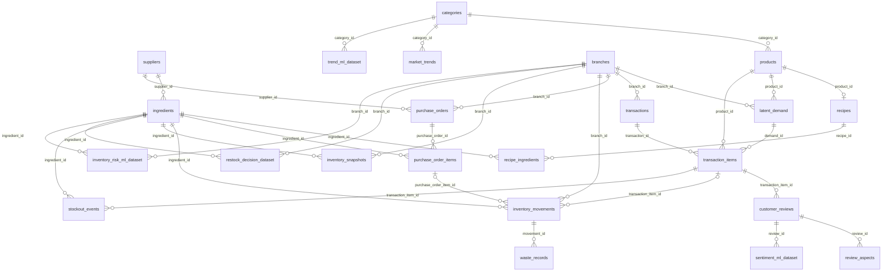

# Entity relationships

Every FK child has exactly one parent (1..1), except the two optional movement references (0..1). Every parent permits 0..N children; recipes.product_id is UNIQUE, so a product permits 0..1 recipe in SQL and exactly one in this generated catalog, enforced by validation. Products and ingredients have a binary N:M relation through recipe_ingredients. Review product and branch are resolved through its purchased item and transaction. No separate customer identity is invented.

Operational entities are normalized to 3NF. ML tables deliberately duplicate decision-time supplier attributes and review fields as immutable experiment snapshots. Recipe, conservation, FEFO, cross-table supplier consistency and temporal rules are enforced by the Python validator; they are not guaranteed by row CHECK constraints alone.

Indexes support FK joins, branch/time sales filters, ingredient movement reconstruction and review history windows. Performance has not been benchmarked. No production migration is run. Rollback: discard the disposable database; this deletes its data and does not restore previous data.