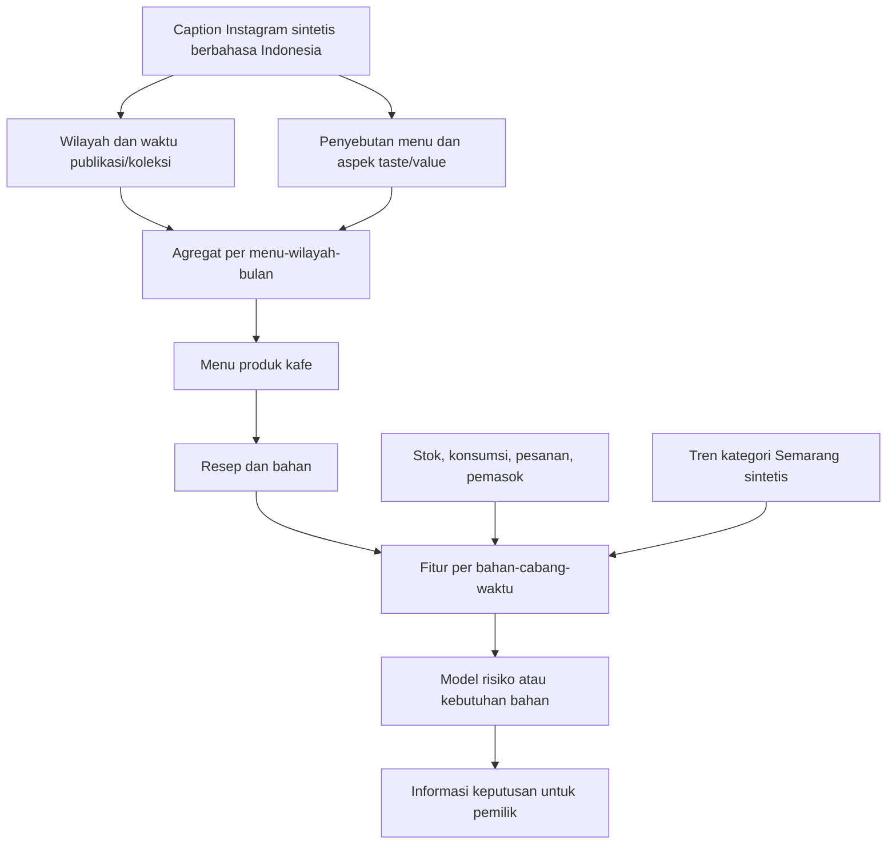

# Dataset Instagram sintetis — pembahasan menu di Semarang

Sesuai keputusan pengguna, skenario memakai Semarang dan platform Instagram;
datanya sintetis untuk eksperimen. Data ulasan kafe, rating dan sumber Yelp telah
dikeluarkan dari input/output aktif. Tidak ada scraping Instagram nyata pada tahap ini.

## Contoh bentuk konten

Contoh ilustrasi teks: "Lagi bahas Es Matcha Latte: rasanya enak dan seimbang.
Menurutku porsi dan rasanya sepadan. Bahasan wilayah Banyumanik. #Semarang"
Ini tidak menilai CafeStock/Andi, tidak terkait pembelian seseorang, dan bukan
kutipan dari akun Instagram nyata. Contoh baris aktual dapat dibaca di
output/social_posts.csv dan dihubungkan melalui post_id ke menu_mentions.csv.

## Relasi utama

| Tabel | Hubungan |
|---|---|
| regions | Semarang kota dan tiga wilayah cabang |
| branches | Cabang memiliki satu region lokal, tetap perusahaan fiktif |
| social_posts | Satu post memiliki lokasi diketahui atau NULL unknown; tidak punya transaction FK |
| menu_mentions | Junction post–product dengan label sentimen menu |
| menu_aspects | Aspek rasa/nilai per mention; mixed mempunyai polaritas berbeda |
| menu_market_signals | Jumlah dan rata-rata sentimen menu–region–bulan |
| recipe_ingredients | Menghubungkan menu ke bahan |
| restock_decision_dataset | Mengambil sinyal menu yang menggunakan bahan pada region kota dan region cabang |

Asal lokasi diberi location_evidence=synthetic_scenario atau unknown. Lokasi yang
tidak diketahui tidak ditebak; tetap boleh menjadi contoh teks sentimen tetapi
tidak masuk sinyal regional. Tidak ada account_id, username, data pribadi, atau
tautan palsu; source_url NULL dan source_post_key berawalan SIM-IG-SMG-.

## Pembaruan bulanan

Koleksi dijadwalkan tanggal 1 bulan berikutnya pukul 07:00 WIB. Contoh: seluruh
postingan November 2025 baru tersedia 1 Desember 2025 pukul 07:00. Keputusan
1 Desember pukul 05:00 belum boleh memakainya; keputusan 2 Desember sudah boleh.
Koleksi sosial tidak melatih ulang model otomatis. Input stok dapat diperbarui
harian memakai batch pasar terakhir yang tersedia serta indikator kesegarannya.

## Arti fitur dan keterbatasan

menu_sentiment_latest_month adalah agregat opini menu regional, bukan tingkat
kepuasan pelanggan kafe. social_post_count_latest_month memberikan dukungan jumlah
observasi. social_data_available membedakan data kosong dari skor netral; lokasi
unknown, batch belum tersedia, serta menu yang tidak relevan tidak dimasukkan.
Source publication dan collection timestamps selalu mendahului decision_at.

Distribusi label, volume postingan dan geografi semuanya asumsi; belum ada bukti
popularitas menu Semarang nyata. Teks template harus diuji overlap dan tidak layak
menjadi satu-satunya bukti generalisasi SVM. Bandingkan fitur operasional saja,
ditambah tren, ditambah sentimen pasar menu, dan keduanya. Jangan mengharuskan
model dengan sentimen menang. Bot/koordinasi konten dan proses scraping nyata
belum diimplementasikan.
