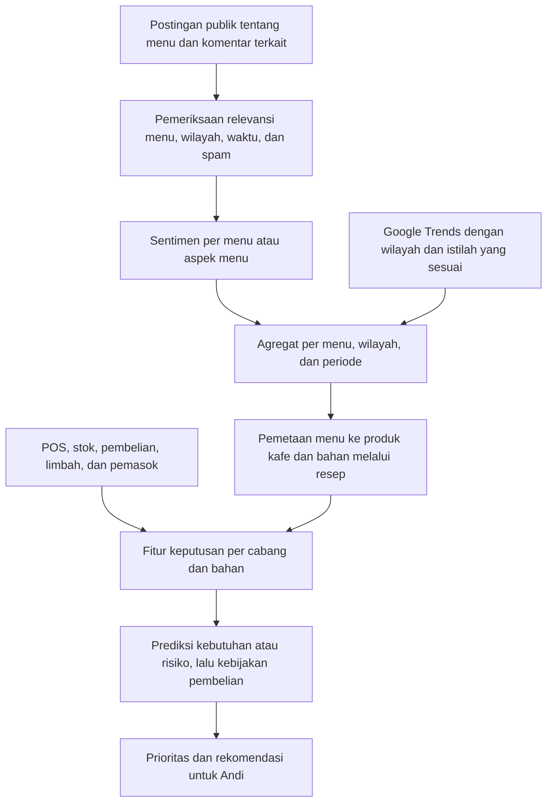

# Rancangan terbaru: sentimen pasar menu berdasarkan wilayah

Pembaruan ruang lingkup, 2026-11-05: sentimen yang diinginkan adalah opini publik
tentang menu/minuman di media sosial pada wilayah pasar yang relevan. Ulasan
tentang kafe Andi sendiri tidak menjadi sumber fitur sentimen operasional.
Dokumen ini menggantikan bagian sumber dan integrasi sentimen pada alur lama.

## Pertanyaan penelitian

Apakah penambahan minat pencarian dan sentimen publik tentang menu pada wilayah
pasar terkait meningkatkan prediksi kebutuhan bahan atau risiko stockout,
dibandingkan penggunaan data operasional kafe saja?

Postingan pasar memberi sinyal minat dan pendapat, bukan bukti pembelian di kafe
Andi. Data penjualan, resep, stok dan pemasok tetap merupakan data internal.

## Alur yang dituju

## Informasi yang dikumpulkan

| Informasi | Tujuan |
|---|---|
| Platform dan ID/URL konten | Menelusuri sumber, deduplikasi dan pembaruan |
| Teks postingan/caption dan komentar relevan | Mengenali menu dan sentimennya |
| Waktu publikasi, waktu pengambilan, dan ID batch | Memisahkan periode serta menjaga ketersediaan fitur |
| Nama menu yang disebut | Memetakan variasi sebutan ke menu standar |
| Lokasi konten jika tersedia | Menentukan relevansi wilayah pasar |
| Dasar penentuan lokasi dan tingkat kepastian | Membedakan lokasi eksplisit, indikasi dan lokasi tidak diketahui |
| Status promosi/iklan jika dapat diketahui | Memisahkan perhatian organik dari materi promosi |
| Engagement jika tersedia | Sinyal tambahan, bukan ukuran penjualan atau keaslian |

Lokasi pembuat akun, tempat yang disebut dalam teks dan lokasi pasar yang dituju
tidak otomatis sama. Jangan menganggap lokasi akun sebagai bukti lokasi semua
kontennya. Jika tidak ada bukti lokasi, tandai unknown; konten itu tidak masuk
agregat wilayah terverifikasi, tetapi dapat dipisahkan sebagai agregat umum.
Lokasi cabang kafe Andi dipetakan ke wilayah pasar yang sudah ditetapkan.

Konten tentang pelayanan/kebersihan suatu kafe tidak otomatis menjadi sentimen
tentang rasa atau minat pada menu. Contoh: "matcha enak tetapi pelayanannya lama"
memiliki sentimen menu positif dan aspek pelayanan negatif. Teks yang menyebut
beberapa menu harus dipetakan pada masing-masing menu bila didukung anotasi/model.
Perlakukan komentar dan postingan dengan jelas agar percakapan yang sama tidak
terhitung sebagai banyak sinyal independen tanpa pemeriksaan.

## Fitur yang direncanakan

- Jumlah konten relevan dan konten unik per menu-wilayah-periode.
- Jumlah opini positif, negatif, netral dan campuran tentang menu.
- Rata-rata skor sentimen dan jumlah opini yang mendasarinya.
- Perubahan volume pembahasan dibanding periode sebelumnya yang sebanding.
- Indeks pencarian historis dan lag yang relevan dengan waktu keputusan.
- Indikator cakupan: sumber tersedia, kesegaran data dan kepastian lokasi.

Volume konten hanya mewakili sampel yang berhasil dikumpulkan. Pertumbuhan bisa
berasal dari perubahan cakupan scraper; simpan cakupan sumber dan perubahan
proses pengambilan. Jangan menyebut volume sampel sebagai pangsa pasar menyeluruh.
Jika memakai rasio, dokumentasikan penyebutnya; rasio positif saja tidak cukup
tanpa jumlah dan periode observasi. Tidak adanya konten bukan berarti sentimen
netral atau permintaan nol.

## Hubungan dengan produk dan bahan

Contoh: pembahasan iced matcha latte di wilayah operasional Andi dipetakan ke
produk Iced Matcha Latte pada katalog kafe, kemudian ke matcha, susu, es, dan
pemanis melalui resep. Menu yang tidak dijual kafe dipisahkan sebagai peluang
menu baru; jangan otomatis membuat rekomendasi stok tanpa produk dan resep.

Menu-wilayah-periode menjadi penghubung fitur eksternal, bukan ID transaksi.
Satu sinyal wilayah dapat digunakan beberapa cabang pada wilayah yang sama,
tetapi riwayat penjualan dan kondisi persediaan tiap cabang tetap berbeda.

## Pembaruan bulanan dan pencegahan leakage

Ambil hanya konten baru/berubah, simpan jejak pembaruan, periksa kualitas, lalu
buat agregat untuk prediksi setelah batch tersebut tersedia. Postingan dengan
tanggal November yang baru dikumpulkan 1 Desember tidak boleh digunakan sebagai
informasi yang seolah-olah sudah tersedia pada keputusan pertengahan November.
Agregat bulanan yang sudah selesai dapat dipakai selama bulan berikutnya dengan
penanda kesegaran. Penjualan dan stok internal tetap dapat diperbarui harian.

Pembaruan data tidak berarti pelatihan ulang otomatis. Model yang sudah dilatih
menerapkan preprocessing tersimpan; data baru hanya masuk training setelah
proses kurasi, anotasi yang sah, evaluasi dan pencatatan versi.

## Ketahanan data dan evaluasi

Perubahan sumber tidak menghilangkan risiko manipulasi. Postingan pasar juga
dapat berisi spam, promosi, pengulangan dan koordinasi. Simpan data mentah,
tandai anomali tanpa menyamakan kritik negatif dengan serangan, serta uji dampak
sinyal eksternal terhadap rekomendasi. Gunakan pembanding operasional ketika
kualitas batch eksternal tidak memenuhi kriteria yang telah diuji.

Bandingkan fitur operasional saja, ditambah tren, ditambah sentimen menu, serta
keduanya; pisahkan volume pembahasan dari polaritas untuk mengukur kontribusinya.
Gunakan pembagian waktu, bukan split acak. Data uji teks harus sesuai bahasa dan
domain media sosial; keberhasilan pada Yelp/template sintetis belum membuktikan
keberhasilan pada komentar media sosial. Label sentimen menu perlu pedoman dan
anotasi terverifikasi; output model tidak otomatis menjadi ground truth.

## Yang sudah ada dan yang perlu diubah

- Generator lama dan output CSV tetap menggambarkan skenario ulasan pembelian
  CafeStock. Data historis dan laporan validasi lama tidak diubah oleh dokumen ini.
- customer_reviews dan review_aspects lama bukan data scraping pasar menu.
- sentiment_mean_14d lama merupakan sentimen ulasan cabang, belum sesuai desain baru.
- Perlu menentukan platform, akses pengumpulan yang diizinkan, bahasa, wilayah
  dan daftar menu target sebelum implementasi scraper dan anotasi.
- Perlu dataset eksternal, pemetaan menu/wilayah, agregasi bertimestamp dan revisi
  feature engineering serta pengujian leakage; belum diimplementasikan.
- geoMap.csv dan multiTimeline.csv yang tersedia berasal dari Indonesia, sedangkan
  simulasi sekarang NYC. Jangan menggabungkannya sebagai pengamatan pasar yang sama.
  Wilayah bisnis dan wilayah sumber baru harus diselaraskan dahulu.
