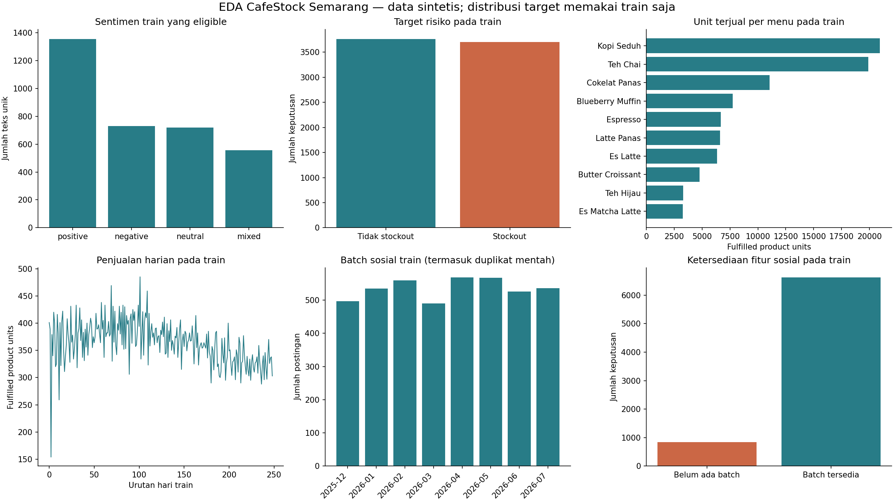

# EDA tahap 03 — data sintetis, outcome train saja

Train sentiment eligible: 3,361 teks unik. Train risiko: 7,470 keputusan.

Temuan: kelas sentimen tidak seimbang; laporkan macro F1 dan metrik per kelas pada tahap evaluasi. Data sosial awal belum mempunyai batch yang selesai dikumpulkan, sehingga availability flag wajib dipakai. Template berulang dikeluarkan dari ML teks; evaluasi pada data ini tetap tidak membuktikan generalisasi Instagram nyata. Tren adalah pola yang diasumsikan simulator dan sentimen tidak dipaksakan sebagai penggerak permintaan.

Grafik unit menu, penjualan harian, distribusi target dan batch hanya mencakup train. Test tidak dipakai untuk memilih model, fitur, atau parameter. Grafik bersifat deskriptif, bukan hasil prediksi.